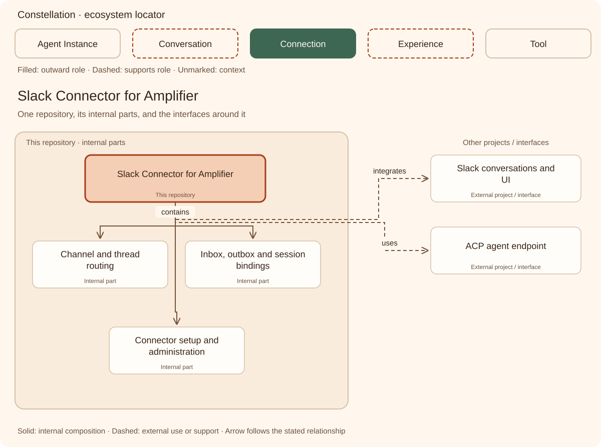

# Slack Connector for Amplifier

Give an existing agent a Slack presence. Invite it into a channel, work with it in
a thread, or send it a direct message. Slack holds the conversations; your chosen
ACP-compatible endpoint supplies the agent.

Part of [Amplifier Constellation](https://github.com/microsoft/amplifier-constellation).

## Get started

1. Install and authorize the agent you want to connect.
2. Download the matching [Slack Connector release](https://github.com/microsoft/amplifier-acp-slack/releases)
   for Windows, macOS or Linux, and extract the complete package.
3. Open the app and choose a local connector password in the browser.
4. Follow the setup screens to connect your agent and authorize your Slack workspace.
5. Invite the Slack app into the channel where you want to work with it.

No system Python or developer toolchain is required. Slack authorization may need
workspace administrator approval. The native preview is unsigned and unnotarized;
verify its checksum and use your operating system's normal review flow.

The connector manages its own installation, credentials and updates. A
Constellation Instance host or fleet manager is not required. Its local browser
interface provides setup and administration; daily conversations happen in Slack.

## Help and integration

- [Native installation, updates and recovery](docs/native-installation.md)
- [Slack authorization and credential renewal](docs/onboarding.md)
- [Existing Linux and source installations](docs/installation.md)
- [Saved agent connections](docs/saved-connections.md) and [agent images](docs/agent-images.md)
- [Management API and architecture](docs/architecture.md)
- [Contributor entry](AGENTS.md)

<!-- ecosystem-map:start -->
## Where this fits

Connects existing ACP agents to Slack-owned conversations and presentation.

Roles: Connection. Supports: Conversation, Experience.

[Open the map](docs/ecosystem-map.svg) · [Product overview](https://microsoft.github.io/amplifier-constellation/projects/amplifier-acp-slack/) · [Map guide](https://github.com/microsoft/amplifier-constellation/blob/main/docs/ecosystem-maps.md)

The five shared building blocks

<!-- ecosystem-map:end -->

## Contributing

Invited collaborators: follow [Join the work](https://github.com/microsoft/amplifier-constellation#join-the-work)
within your agreed access and scope. The notice below covers general public intake.

> [!NOTE]
> This project is not currently accepting external contributions, but we're actively working toward opening this up. We value community input and look forward to collaborating in the future. For now, feel free to fork and experiment!

Most contributions require you to agree to a
Contributor License Agreement (CLA) declaring that you have the right to, and actually do, grant us
the rights to use your contribution. For details, visit [Contributor License Agreements](https://cla.opensource.microsoft.com).

When you submit a pull request, a CLA bot will automatically determine whether you need to provide
a CLA and decorate the PR appropriately (e.g., status check, comment). Simply follow the instructions
provided by the bot. You will only need to do this once across all repos using our CLA.

This project has adopted the [Microsoft Open Source Code of Conduct](https://opensource.microsoft.com/codeofconduct/).
For more information see the [Code of Conduct FAQ](https://opensource.microsoft.com/codeofconduct/faq/) or
contact [opencode@microsoft.com](mailto:opencode@microsoft.com) with any additional questions or comments.

## Trademarks

This project may contain trademarks or logos for projects, products, or services. Authorized use of Microsoft
trademarks or logos is subject to and must follow
[Microsoft's Trademark & Brand Guidelines](https://www.microsoft.com/legal/intellectualproperty/trademarks/usage/general).
Use of Microsoft trademarks or logos in modified versions of this project must not cause confusion or imply Microsoft sponsorship.
Any use of third-party trademarks or logos are subject to those third-party's policies.
